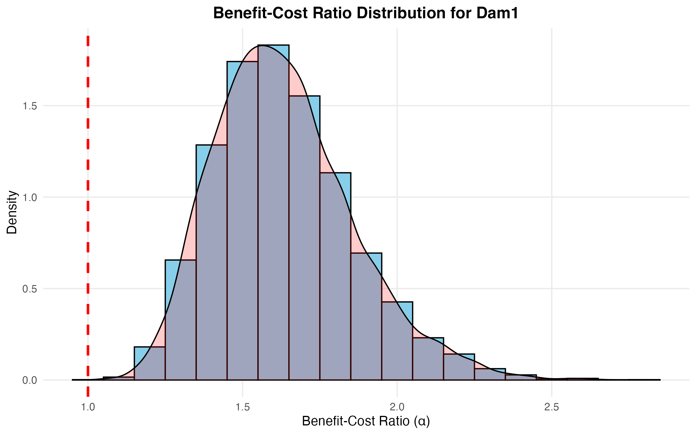
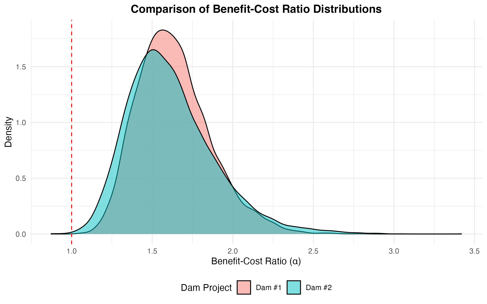
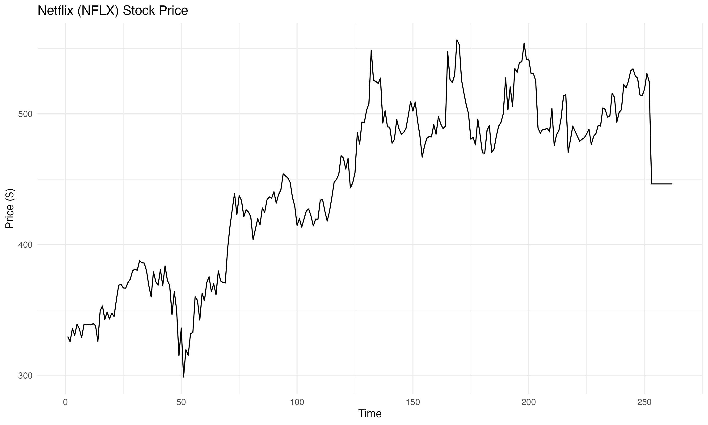
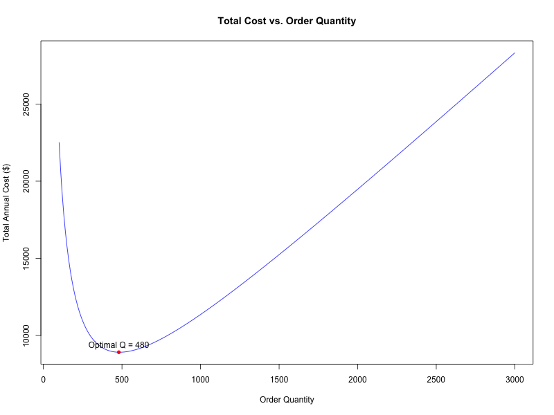
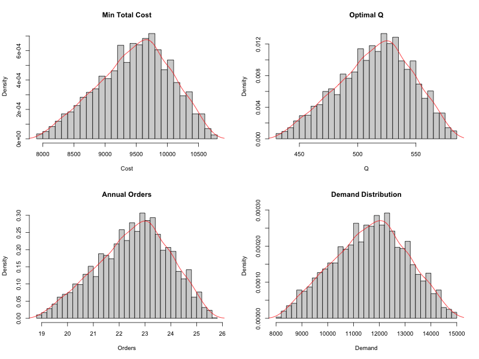

# Transportation Optimisation — Waste Shipping and Transshipment

Six modules from Northeastern's ALY6050 Introduction to Enterprise Analytics course (professor Zhi He, 2025), in R. The first five modules build the toolkit — simulation, benefit-cost analysis, forecasting, inventory modelling, and linear programming — and Module 6 is the final project: optimising how hazardous waste is shipped from six plants to three disposal sites, comparing direct shipping with transshipment, plus a second optimisation problem on investment portfolios.

## In plain language

Enterprise analytics is about making better business decisions with numbers, not gut feel. Each module practises a different decision tool:

- **Module 1 — betting strategy simulation:** if you bet on a sports series, does the order of home and away games change whether the bet makes money? Simulated 3,000 times, then checked against the exact theoretical probability.
- **Module 2 — benefit-cost analysis of dam construction:** two dam projects, each with uncertain benefits and costs. Simulate 10,000 possible outcomes for each and ask: which dam is more likely to be worth it?
- **Module 3 — time series forecasting:** given a year of daily Amazon and Netflix stock prices, which forecasting method predicts the next days best?
- **Module 4 — inventory management:** how much should a company order at once so that ordering costs and holding costs together are as low as possible, first with fixed demand, then with uncertain demand?
- **Module 5 — linear programming for a hardware distributor:** with a fixed budget and fixed warehouse space, how many of each product should be ordered to maximise monthly profit?
- **Module 6 — final project, transportation optimisation:** six plants generate waste every week and three disposal sites can take it. Is it cheaper to ship directly, or to route through other plants first? And separately, how should $1,000,000 be split across six assets to hit a return target with the least risk?

## What is in this repo

### Betting Strategy Simulation: Does Home-Field Order Change a Bet?
Folder: `betting-strategy-simulation-best-of-series/`
Files: `New_ALY6050_MOD1Project_PanchalDev.R`, `New_ALY6050_MOD1Project_PanchalDev.docx`
What it does: simulates a fictional Major League Soccer series between the New England Revolution and Houston Dynamo FC. A bet pays $50 when the Revolution win and loses $52 when they lose. Home win probability for the Revolution is 0.59; away it is 0.43. Four formats, 3,000 simulations each:
- Best-of-3, Revolution home first (REV–HOU–REV): theoretical Revolution win probability **55.61%**, expected net gain **$4.23**, 90% confidence interval **[$2.10, $6.36]** — entirely above zero.
- Best-of-3, Dynamo home first (HOU–REV–HOU): theoretical probability **47.41%**, expected net gain **−$4.13**, interval **[−$6.26, −$1.99]** — entirely below zero.
- Best-of-5, alternating from the Revolution's home: theoretical probability **54.94%**, expected net gain **$5.20**, interval **[$2.95, $7.45]**.
- Best-of-7, Revolution home in Games 3, 4 and 6: theoretical probability **49.67%**, expected net gain **−$4.50**, interval **[−$7.85, −$1.15]**.
Takeaway: the same bet flips from profitable to losing purely on the order of home games.

### Benefit-Cost Analysis: Which Dam Is Worth Building?
Folder: `benefit-cost-analysis-dam-construction/`
Files: `ALY6050_MOD2Project_ PanchalD.R`, `ALY6050_MOD2Project_ PanchalD.docx`
What it does: for JET Corporation's two dam projects — Dam #1 in Southwest Georgia and Dam #2 in North Carolina — models every benefit and cost with a triangular distribution (minimum, most likely, maximum) and simulates 10,000 benefit-cost ratios (total benefits divided by total costs) for each dam.
- Dam #1: mean ratio **1.634**, median **1.610**, standard deviation **0.225**, P(ratio > 1) = **1.000**, P(ratio > 1.2) = **0.9934**, P(ratio > 1.5) = **0.7017**.
- Dam #2: mean ratio **1.617**, median **1.578**, standard deviation **0.273**, P(ratio > 1) = **0.9995**, P(ratio > 1.2) = **0.9726**, P(ratio > 1.5) = **0.6277**.
- Direct comparison: Dam #1 has a **64.36%** chance of outperforming Dam #2. Dam #1 wins on mean, on consistency, and on the chance of a high return, so it is the recommended project.

### Time Series Forecasting: Amazon and Netflix Stock Prices
Folder: `time-series-forecasting-amazon-netflix/`
Files: `ALY6050_MOD3Project_ PanchalD.R`, `ALY6050_Module3_Report_DevPanchal.docx`
Data: `data/ALY6050_MOD3Project_Data_2025SpringB.csv` — the file the code reads: daily closing prices for Amazon (AMZN) and Netflix (NFLX) over 252 trading days in 2020.
What it does: compares forecasting methods by MAPE (mean absolute percentage error — lower is better).
- Simple exponential smoothing: best MAPE **1.92%** for AMZN and **2.07%** for NFLX, both at smoothing parameter 0.65.
- Holt's trend-adjusted smoothing: best MAPE **2.01%** for AMZN and **2.26%** for NFLX, both at trend parameter 0.20.
- Three-period weighted moving average (weights 0.25, 0.30, 0.45): MAPE **2.02%** for AMZN and **2.19%** for NFLX.
- Linear trend model fitted on periods 51–252 and forecast to periods 253–262: MAPE **1.51%** for AMZN and **2.91%** for NFLX.
Takeaway: no single method wins for both stocks — simple smoothing is best for short-term AMZN, while the trend model is best for AMZN further out and weaker for NFLX.

### Inventory Management: How Much to Order at Once?
Folder: `inventory-management-eoq-and-simulation/`
Files: `ALY6050_Module4Project_PanchalD.R`, `ALY6050_Module4_PanchalD.docx`, `ALY6050_Module4Project_PanchalD.xlsx`
What it does: first, a deterministic model with annual demand 12,000 units, unit cost $159.99, holding rate 11.5%, and order cost $179.99; then a simulation with uncertain demand.
- Economic order quantity (EOQ): **484.55 units**, minimum total annual cost about **$8,915**, ordering roughly every **14.6 days**.
- Company policy of ordering 1.8 times the EOQ (872.19 units) costs more than ordering at the EOQ — the policy premium is real, not just theoretical.
- Simulation (demand triangular, minimum 8,000, most likely 12,000, maximum 15,000 units, 3,000 runs): mean minimum total cost about **$9,483**, 95% confidence interval **[$9,352, $9,614]**; mean optimal order quantity about **512 units**, interval **[498, 526]**; mean orders per year about **23.2**, interval **[22.5, 24.0]**. A lognormal distribution fits the simulated costs slightly better than a normal distribution.
The workbook is the Module 4 inventory model sheet with its chart.

### Hardware Distribution: The Most Profitable Monthly Mix
Folder: `hardware-distribution-linear-programming/`
Files: `ALY6050_Module5_PanchalD.R`, `ALY6050_Module5_PanchalD.docx`
What it does: maximises monthly profit for a northern hardware company's distribution centre, subject to a $130,000 budget, 7,500 sq ft of space, and marketing-mix constraints, for four products.
- Optimal monthly order: **0 pressure washers, 72 lawn mowers, 153 snow blowers, 11 water pump cases** (each case is 4 pumps).
- Total investment **$129,741.80**, total revenue **$169,097.30**, total profit **$39,355.56**, return on investment **30.33%**, profit margin **23.27%**.
Takeaway: the cheapest product is not automatically worth ordering — at these prices and space requirements, pressure washers earn too little per square foot to make the cut.

### Transportation and Portfolio Optimisation: The Final Project
Folder: `transportation-and-portfolio-optimization-final-project/`
Files: `ALY6050_Module6_Part1Code_PanchalD.R`, `ALY6050_Module6_Part2Code_PanchalD.R`, `ALY6050_Module6_PanchalD.docx`
What it does, Part 1 — transportation: Rockhill Shipping & Transport Company must move hazardous waste each week from six plants (Denver 40, Morganton 33, Morrisville 42, Pineville 55, Rockhill 27, Statesville 43 barrels; 240 total) to three disposal sites (Orangeburg 55, Florence 70, Macon 125 barrels capacity).
- Direct shipping (each plant straight to a site): optimal total cost **$2,873** per week, using 96% of total disposal capacity.
- Transshipment (allowing intermediate stops at other plants or sites): optimal total cost **$2,623** per week — **$250 less, an 8.70% saving**. Morganton emerges as the key consolidation hub (for example, Pineville via Morganton to Florence, and Pineville via Morganton to Macon).
- Expanding capacity further saves only $60 under direct shipping and $10 under transshipment, so network design beats simply adding capacity.
What it does, Part 2 — portfolio: split $1,000,000 across bonds, high-tech stocks, foreign stocks, call options, put options, and gold to hit a return target with minimum risk.
- Efficient frontier: risk (standard deviation) rises from **4.76%** at an 8% target return, to **5.32%** at 10%, **6.57%** at 12%, **7.95%** at 14%, **8.73%** at 15%, and **9.77%** at 16%.
- At a 15% target return: bonds **0%**, high-tech stocks **8.71%** ($87,103), foreign stocks **22.10%** ($221,039), call options **17.11%** ($171,131), put options **31.26%** ($312,602), gold **20.81%** ($208,126). Risk-adjusted performance peaks at the 15% target, with a Sharpe ratio of **1.031** (using the 6% bond return as the risk-free rate).

### Charts
Folder: `images/` — seven charts from the modules: Dam #1 benefit-cost histogram and the dam comparison plot, Amazon and Netflix time-series plots, inventory total-cost and sensitivity plots, and the portfolio efficient frontier. Modules 1 and 5 have no separate chart files; their results are in their reports' tables.

## How to use it

1. Install R and RStudio.
2. For Module 3, put `data/ALY6050_MOD3Project_Data_2025SpringB.csv` where the Module 3 code expects it. Modules 1, 2, 5, and 6 define their values in the code itself and need no external dataset file; Module 4 likewise, plus its workbook.
3. Open a module's code file in RStudio and run it top to bottom. Each module creates its own plots as it runs.
4. Read the matching `.docx` report for the written-up results.

## Tools

R, lpSolve, lpSolveAPI, quadprog, forecast, triangle, ggplot2, dplyr, fitdistrplus.

## What was left out, and why

Only the submitted version of each module (code + report, plus the Module 4 workbook) is included. For Module 1, the "New" final version is used; the earlier copy in the Module 1 folder is not double-uploaded. Working copies in Assignments folders, assignment briefs, and professor material are not included. Module 3's dataset is included once, in `data/`, not duplicated per module.

## Conclusion

Together, the six modules show the full arc of enterprise analytics: simulate a risky bet before taking it, compare two investments under uncertainty, forecast what comes next, order the right amount, allocate scarce budget and space, and finally optimise a whole shipping network and a whole portfolio. The through-line is practical: every module ends in a decision — which series order to bet on, which dam to build, which forecast to trust, how much to order, what to stock, and whether to route waste through a hub — with the numbers that justify it, not just the method that produced it.
